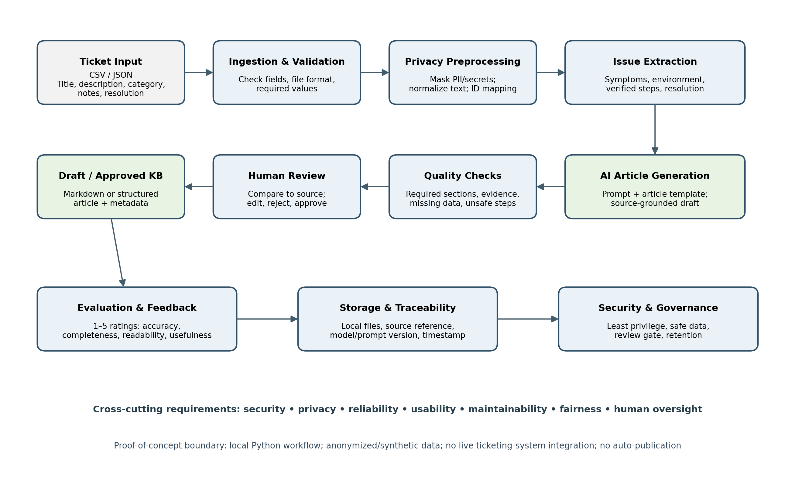

# Architecture

Pipeline modules map to `src/kbgen/`: `ingest.py` (Module 1), `privacy.py` (Module 2), `generate.py` (Modules 3-5 prompt and checks). Review, storage, and evaluation modules are planned.

Design rules: ticket text is untrusted data; the model may use only supplied fields; missing details are marked "not documented"; drafts are never auto-published.
